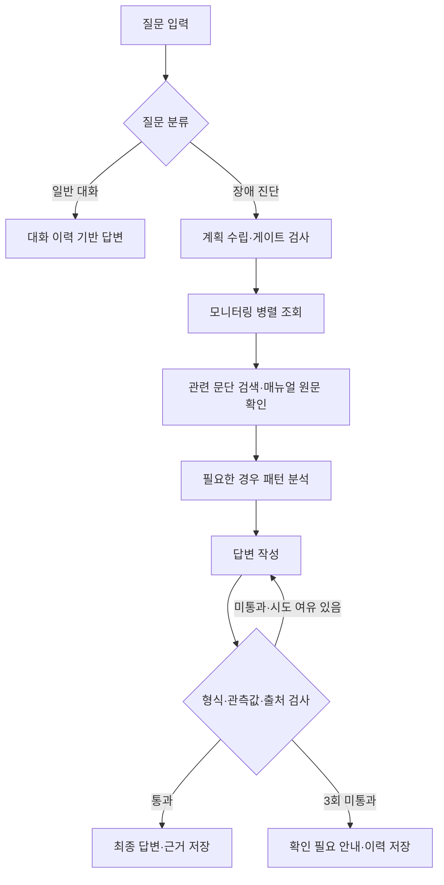
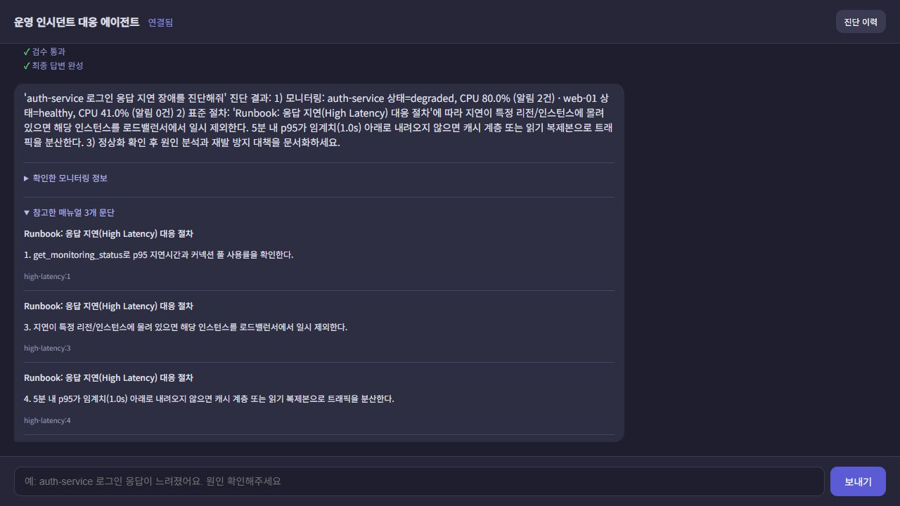
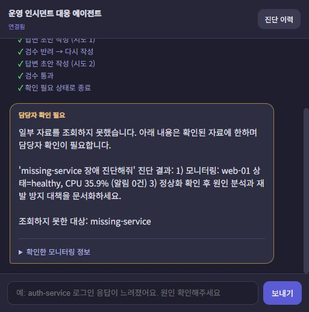
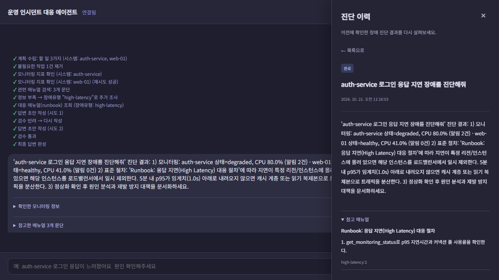
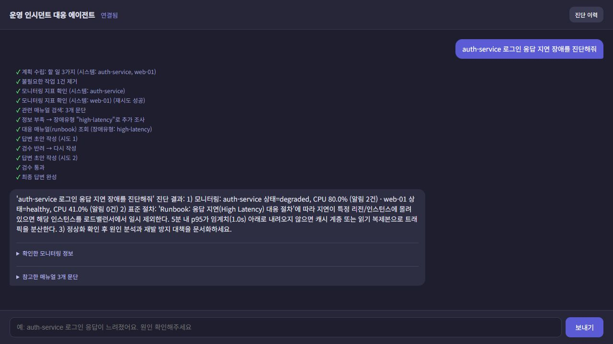
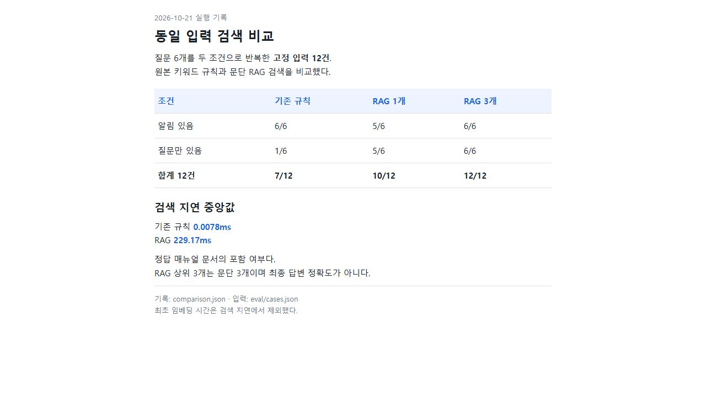

# G099 채수아

## 운영 인시던트 대응 에이전트 개선

**과제 1 · 기존 프로젝트 발전시키기**

장애 증상을 입력하면 시스템 상태와 대응 매뉴얼을 조회하고, 확인한 자료를 바탕으로 대응 절차를 작성하는 서비스다. 기존 프로젝트에 **매뉴얼 RAG 검색, 답변 근거 검사, 조회 실패 격리, 진단 이력**을 추가·개선했다.

## 1. 진행 사항

| 항목 | 원본 | 개선 내용 |
|---|---|---|
| 매뉴얼 검색 | 알림 키워드로 문서 선택, 미매칭 시 DB Down 선택 | `search_runbook` MCP Tool로 관련 문단 3개 검색, Resource 원문과 대조 |
| 답변 검증 | 길이·번호 형식 검사, 마지막 시도 강제 통과 | 관측값·상태·출처 검사, 최대 3회 작성 후 미통과 시 확인 필요 종료 |
| 조회 실패 | 작업 하나의 예외가 전체 조사에 영향 | 성공 자료 보존, 실패 대상 별도 기록 |
| 진단 이력 | 대화 메시지 저장 | 질문·답변 검색, 상태 필터, 결과·근거 상세 조회 |

원본 소스는 커밋 `d4c76d5`에 보존했다. FastAPI·LangGraph·MCP·SQLite·Vue의 기본 구조를 활용하고, 검색과 검증 모듈을 추가했다.

## 2. 사용 기술과 구현

### 처리 흐름



모델은 질문 분류·조사 계획·설명 작성을 맡고, 코드는 도구 실행·검색·검증·재작성 제한·저장을 담당한다. 조회 자료가 전혀 없으면 작성을 생략한다. 일부 조회가 실패했다면 검증을 통과하더라도 `확인 필요` 상태로 저장한다.

### 주요 기능

**매뉴얼 RAG 검색** — Markdown 매뉴얼 6개를 번호별 절차에 따라 28개 문단으로 나눠 SQLite에 임베딩과 함께 저장한다. 에이전트는 `search_runbook` MCP Tool에 질문과 관측 정보를 전달한다. 도구가 임베딩과 코사인 유사도로 상위 3개 문단을 반환하면 MCP Resource로 원문을 다시 확인한다. 문서 해시나 모델명이 달라지면 인덱스를 갱신하며, 임베딩 요청에 실패하면 규칙 검색으로 대체하고 사유를 기록한다. 규칙에도 맞지 않으면 임의의 매뉴얼을 선택하지 않는다.

**답변 근거 검사** — CPU·메모리 수치와 시스템 상태를 관측 자료에 대조하고, `[cpu-spike:3]` 같은 인용 ID가 실제 확인한 출처인지 검사한다. 관측값이 `78.2%`인데 초안이 `99%`라고 쓰면 실패 이유를 전달해 다시 작성한다. 최대 3회 후에도 실패하면 잘못된 초안을 확정하지 않는다.

**조회 실패 격리** — `asyncio.gather(..., return_exceptions=True)`로 작업별 성공과 실패를 구분한다. 미등록 시스템의 `unknown` 상태는 정상 자료로 사용하지 않으며, 성공한 조회 결과와 실패 대상을 함께 보존한다.

**진단 이력** — 질문·답변·상태·검증 횟수·실패 대상과 관측값·참고 문단을 저장한다. 검색, 완료·확인 필요 필터, 상세 조회를 제공하며 서버 재시작 후에도 기록이 유지된다.

### 사용 기술

| 기술 | 적용 내용 |
|---|---|
| FastAPI·의존성 주입 | 서버 시작 시 연결을 생성하고 `SupervisorDeps`로 노드에 전달 |
| Multi-Agent 역할 분리 | Supervisor가 조사·분석·작성 역할을 노드로 조정 |
| LangGraph | 노드 간 공유 상태, 추가 조사와 검증·재작성 조건부 분기 |
| MCP | 기존 지표 조회 Tool·매뉴얼 Resource·진단 Prompt에 `search_runbook` 검색 Tool 추가 |
| RAG·SQLite | 문단 임베딩·코사인 검색, 인덱스·대화·진단 결과 저장 |
| 모듈화 | 흐름·검색·검증·저장 역할 분리, 테스트에서 검색 의존성 교체 |
| Vue·SSE | 진행 상황, 최종 답변, 관측값·출처, 진단 이력 표시 |
| unittest·httpx 모의 응답 | 정상·실패 흐름, 저장, 모델 전환과 API 오류 처리 검사 |
| LangSmith | 기존 추적 코드 유지. 기본 비활성화, 실제 추적 화면 미검증 |

### MCP 인터페이스

| 구분 | 이름 | 입력과 결과 |
|---|---|---|
| Tool | `get_monitoring_status` | 시스템명 → 상태·CPU·메모리·알림 |
| Tool | `search_runbook` | 질문·관측 정보 → 관련 문단·출처 ID·유사도·검색 방식 |
| Resource | `get_incident_runbook` | 장애 유형 → 매뉴얼 Markdown 원문 |
| Prompt | `incident_analysis_prompt` | 시스템·증상 → 표준 조사 절차 |

`replan_check_node`의 검색 요청은 MCP 클라이언트를 거쳐 `search_runbook`으로 전달된다. MCP 서버는 기존 `RunbookSearch`를 재사용하고 `mode`, `hits`, `fallback_reason`을 반환한다. 임베딩 오류는 규칙 검색으로 대체하며, MCP 호출 자체가 실패하면 검색 불가로 기록하고 관측 자료를 보존한다.

### 코드와 데이터

```text
server.py                 API, 의존성 생성, SSE 중계
web_demo_server.py        화면 제공, 백엔드 프록시
web_chat.html             채팅, 근거 표시, 진단 이력
agent/graph.py            조사·추가 계획·검증·재작성 흐름
agent/rag.py              문단 분리, 임베딩, 인덱스, 유사도 검색
agent/validation.py       관측값·상태·출처 검사
agent/session_store.py    대화·진단 저장과 검색
mcp_server.py             Tool·Resource·Prompt
data/                     실습 지표, 원본 매뉴얼 6개
tests/                    단위·API 테스트
eval/cases.json           고정 검색 비교 입력
scripts/                  설치·실행·검증 명령
```

기본 DB는 프로젝트 루트의 `session.db`이며, `SESSION_DATABASE`로 경로를 변경한다. 서버가 테이블을 준비하고 기존 진단 테이블에 필요한 상세 정보 열을 추가한다.

| 테이블 | 저장 내용 |
|---|---|
| `messages` | 세션별 대화 |
| `diagnoses` | 진단 결과·상태·검증 정보·근거·조회 실패 대상 |
| `runbook_chunks` | 문단·임베딩·문서 해시·모델명 |

**모니터링 값은 `data/monitoring.json`에 작은 변동을 더한 실습 데이터**다. 실제 운영 서버의 지표 수집이나 서버 재시작·티켓 등록은 수행하지 않는다. `.env`, 가상환경, DB, 모델 파일은 Git에 포함하지 않는다.

### 주요 API

| 인터페이스 | 역할 |
|---|---|
| `GET /health` | 실행 상태와 모델 구성 확인 |
| `POST /chat` | 답변·진행 이벤트·구조화된 metadata 반환 |
| `GET /chat/stream` | 진행 SSE와 검증을 마친 최종 답변 반환 |
| `GET /diagnoses?q=&status=` | 최신 100건 이내 검색·상태 필터 |
| `GET /diagnoses/{id}` | 저장된 결과와 근거 상세 조회 |

## 3. 구현 기능과 실행 결과

### 매뉴얼 검색과 출처 확인

관련 문단 세 개를 펼쳐 본 화면이다. 문서 제목과 문단 ID, 실제 사용한 본문을 답변과 함께 확인할 수 있다.



### 조회 실패 처리

`missing-service 장애 진단해줘`를 입력한 결과다. 조회하지 못한 대상은 따로 안내하고, 성공한 web-01 자료를 이용해 확인 필요 상태로 저장했다.



### 진단 이력

저장한 진단의 상태, 답변과 참고 문단을 다시 조회한 화면이다. 이력 목록에서는 질문·답변 검색과 상태 필터를 사용할 수 있다.



### 최종 실행 화면

`auth-service 로그인 응답 지연 장애를 진단해줘`를 입력했다. 모니터링 조회, 문단 검색, 매뉴얼 원문 확인을 거쳐 답변을 작성했다. 첫 초안은 형식 검사에서 반려됐고, 두 번째 작성에서 검증을 통과했다.



위 기능 화면은 fake 작성 모델과 실제 Ollama 임베딩 검색을 연결해 촬영했다. 고정 응답을 사용한 흐름 확인과 실제 생성 모델 실행 결과는 아래 검증 결과에서 구분한다.

### 시연 입력

| 시나리오 | 입력·조작 | 확인할 결과 |
|---|---|---|
| 장애 진단 | `auth-service 로그인 응답 지연 장애를 진단해줘` | 조사 진행, 최종 답변, 관측값·문단 출처 |
| 이력 검색 | 진단 이력에서 `auth-service` 검색 | 저장된 답변과 근거 상세 |
| 빈 결과·상태 필터 | 없는 검색어 입력 / 확인 필요 선택 | 빈 결과 안내 / 해당 상태만 표시 |
| 기록 유지 | 새로고침·서버 재시작 후 이력 조회 | 이전 결과 유지 |
| 일부 조회 실패 | fake 모드에서 `missing-service 장애 진단해줘` | web-01 자료 보존, 미등록 대상 실패 안내, 확인 필요 저장 |

## 4. 검증과 개선 전후 비교

검색 비교와 실제 모델 연결은 2026-10-21에 확인했다. 자동 테스트는 2026-10-22 기준이다.

```powershell
# fake 모델·임시 DB·모의 API 응답으로 기능 검사
powershell -ExecutionPolicy Bypass -File scripts/test.ps1

# 설정된 임베딩 모델로 고정 입력 검색 비교
.\.venv\Scripts\python.exe scripts/evaluate.py

# Ollama 생성 모델 연결 확인
.\.venv\Scripts\python.exe scripts/check_model.py
```

### 자동 테스트 · 34개 통과

- 정상 진단, 일부·전체 조회 실패, 미등록 대상 처리
- 잘못된 관측값·출처 검사, 재작성 한도, 미통과 답변 확정 방지
- SSE 최종 결과 저장, 이력 검색, 재시작 후 기록 유지
- 인덱스 재사용·갱신, 임베딩 장애 시 규칙 검색 대체
- 모델 연결 설정, API 키 누락, 임베딩 응답·오류 처리

MCP 하위 프로세스는 실제로 연결하며, 그래프의 `search_runbook` 호출과 검색 도구 실패 시 관측 자료 보존을 검사한다. 브라우저에서는 관측값·출처 표시, 이력 검색·빈 결과·상태 필터, 새로고침 후 기록 유지도 확인했다.

### 검색 개선 전후

질문 6개를 `알림 있음`과 `질문만 있음`으로 나눈 고정 입력 12건을 사용했다. 기존 규칙은 원본의 키워드 분류와 미매칭 시 DB Down 선택을 재현했다. RAG는 `qwen3-embedding:0.6b`를 사용했다.

| 입력 조건 | 기존 규칙 | RAG 첫 문단 | RAG 상위 3개 문단 |
|---|---:|---:|---:|
| 알림 있음 · 6건 | 6/6 | 5/6 | 6/6 |
| 질문만 있음 · 6건 | 1/6 | 5/6 | 6/6 |
| 정답 문서 포함 · 합계 | 7/12 | 10/12 | 12/12 |

검색 지연 중앙값은 규칙 **0.0078ms**, RAG **229.17ms**였다. 최초 28개 문단의 임베딩 생성은 별도로 약 **3.75초**가 걸렸다.

알림이 비어 있는 CPU 질문에서 기존 규칙은 DB Down을 선택했지만, RAG는 CPU 매뉴얼을 상위 결과에 포함했다. 자연어 질문에서 검색 범위가 개선되는 대신 지연이 추가됐다.

수치는 **정답 매뉴얼 문서의 포함 여부**다. 상위 3개 문단에 같은 문서가 중복될 수 있으며, 문단별 정답률·최종 답변 정확도·전체 처리 시간을 뜻하지 않는다. 고정 입력은 `eval/cases.json`에 있다.



`scripts/evaluate.py`의 저장된 실행 결과를 표시한 캡처다. 두 검색 방식에 같은 질문과 관측 자료를 전달했다.


### 답변 검증 개선 전후

관측값을 고정하고 정상 답변 1건과 CPU·메모리·상태·대상 시스템·출처가 잘못된 답변 5건을 검사했다.

| 검사 방식 | 정상 1건 | 오류 5건 |
|---|---|---|
| 기존 길이·번호 형식 검사 | 통과 | 모두 통과 |
| 개선한 근거 검사 포함 | 통과 | 모두 반려 |

구성한 오류 사례의 결과이며, 일반적인 환각 탐지율을 의미하지 않는다.

### 실제 모델 확인

| 항목 | 확인 내용 |
|---|---|
| Ollama 구성 | 분류·계획 qwen3:0.6b / 작성 qwen3:8b / 임베딩 qwen3-embedding:0.6b |
| 입력 | `auth-service 로그인 응답 지연 장애를 진단해줘` |
| 성공 사례 | 25.25초, 검증 1회 통과, 완료 상태와 출처 3개 저장 |
| 추가 확인 | 같은 질문을 소형 모델이 일반 대화로 오분류한 사례도 확인 |
| OpenAI | 요청·응답과 오류 처리는 모의 응답으로 검사. 실제 API 호출 미검증 |

Ollama 성공 사례는 단일 실행 결과이며 품질이나 속도의 대표값으로 해석하지 않는다. 최종 화면 시연에는 **fake 작성 모델과 실제 Ollama 임베딩 검색**도 사용해 재작성·저장 흐름을 확인했다.

## 5. 느낀점과 이후 개선사항

관련 문서를 찾는 것과 올바른 답변을 만드는 것은 별개의 문제였다. 검색 이후에도 관측값과 출처를 확인하고, 일부 조회가 실패했을 때 확인한 사실과 확인하지 못한 부분을 구분하는 처리가 필요했다.

현재는 매뉴얼 6개와 고정 입력 12건을 사용한 소규모 검증이다. 정규식 검사는 지원하지 않는 표현이나 수치 생략, 잘못된 조치 권고를 놓칠 수 있다. 모델 서버 장애 시에는 요청 오류를 안내하며 생성 복구는 제공하지 않는다.

- **분류 안정성:** 소형 모델의 오분류 사례를 늘려 검사하고, 분류 결과 확인·재시도 보완
- **검색 평가:** 문단별 정답 자료와 별도 검증 질문을 추가해 검색 실패·다른 유형 혼입 확인
- **답변 검증:** 관측값을 구조화해 전달하고 지원 표현과 조치 검증 범위 확대
- **운영 연결:** 실제 모니터링 API와 사용자 인증 연결. 현재는 단일 사용자 로컬 실행 기준
## 6. 실행 방법

### 환경 준비

확인 환경은 Windows와 Python 3.14.4다. 프로젝트 루트의 PowerShell에서 실행한다.

```powershell
powershell -ExecutionPolicy Bypass -File scripts/setup.ps1
```

가상환경과 의존성을 설치하고, `.env`가 없으면 `.env.example`을 복사한다. Vue는 CDN을 사용하므로 화면 로딩 시 인터넷 연결이 필요하며, 별도 Node 빌드는 필요 없다.

### 실행 설정

`.env`에서 사용할 모델과 접속 주소를 설정한다. 기본 구성은 로컬 Ollama이며, 분류·계획과 답변 작성에 서로 다른 모델을 사용한다.

| 설정 | 기본값 | 용도 |
|---|---|---|
| `LLM_BACKEND` | `1` | Ollama: `1`, OpenAI: `2` |
| `OLLAMA_FAST_MODEL` | `qwen3:0.6b` | 분류·계획 |
| `OLLAMA_QUALITY_MODEL` | `qwen3:8b` | 답변 작성 |
| `EMBEDDING_MODEL` | `qwen3-embedding:0.6b` | 매뉴얼 검색 |
| `OLLAMA_BASE_URL` | `http://127.0.0.1:11434` | Ollama 주소 |

Ollama를 실행하고 필요한 모델을 준비한다. 이미 설치된 모델은 다시 받을 필요 없다.

```powershell
ollama pull qwen3:0.6b
ollama pull qwen3:8b
ollama pull qwen3-embedding:0.6b
```

서버가 실행 중이지 않으면 별도 터미널에서 `ollama serve`를 실행한다.

OpenAI를 사용하는 환경에서는 다음과 같이 설정한다. 생성과 임베딩이 함께 전환되며 API 사용량에 따라 비용이 발생한다.

```dotenv
LLM_BACKEND=2
OPENAI_API_KEY=발급받은_API_키
OPENAI_FAST_MODEL=gpt-4o-mini
OPENAI_QUALITY_MODEL=gpt-4o
OPENAI_EMBEDDING_MODEL=text-embedding-3-small
```

설정 변경 후에는 백엔드를 재시작한다. 기존 `ollama`, `openai`, `fake` 이름도 사용할 수 있으며, API 키가 담긴 `.env`는 Git에서 제외한다.

### 서버 실행

추가 기능은 `.env`의 `SUPERVISOR_VERSION=v2`를 기준으로 실행한다.

```powershell
# 터미널 1: 백엔드
powershell -ExecutionPolicy Bypass -File scripts/start-backend.ps1

# 터미널 2: 프런트엔드
powershell -ExecutionPolicy Bypass -File scripts/start-frontend.ps1
```

| 접속 주소 | 용도 |
|---|---|
| http://127.0.0.1:8630 | 채팅·진단 이력 화면 |
| http://127.0.0.1:8130/docs | API 문서 |

종료할 때는 각 터미널에서 `Ctrl+C`를 누른다. 실행 시 `-Option 1` 또는 `-Option 2`를 지정하면 해당 실행에만 연결 설정을 적용한다.

문단 인덱스는 검색 시 자동 생성·갱신한다. `.env` 설정을 기준으로 미리 생성하려면 다음 명령을 실행한다.

```powershell
.\.venv\Scripts\python.exe -m agent.rag
```

### 모델 없이 흐름 확인

```powershell
$env:LLM_BACKEND='fake'
$env:RUNBOOK_SEARCH='rules'
powershell -ExecutionPolicy Bypass -File scripts/start-backend.ps1
```

`fake`는 정해진 응답을 반환한다. 실제 모델로 돌아갈 때는 새 터미널을 사용하거나 위 환경변수를 제거한다.
